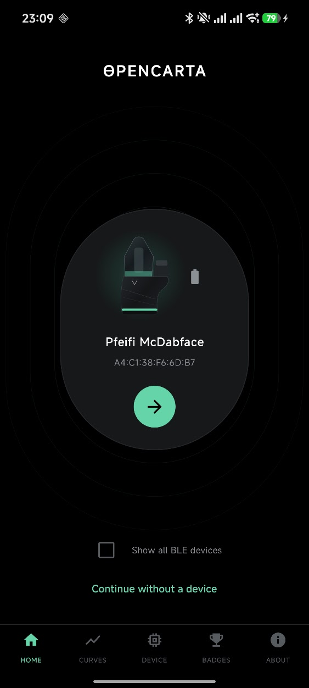
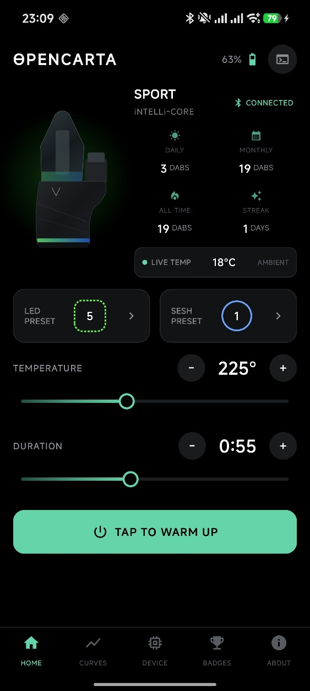
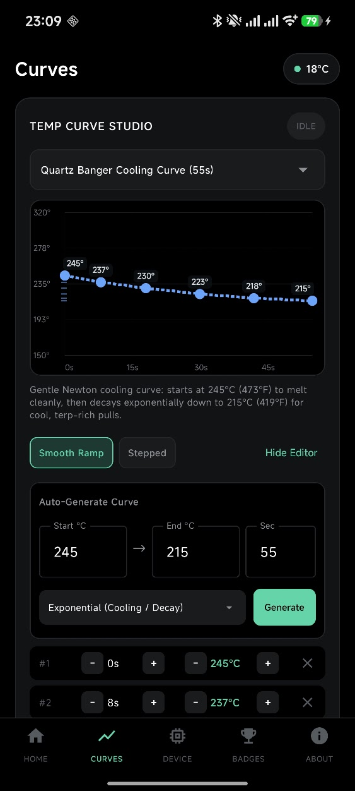
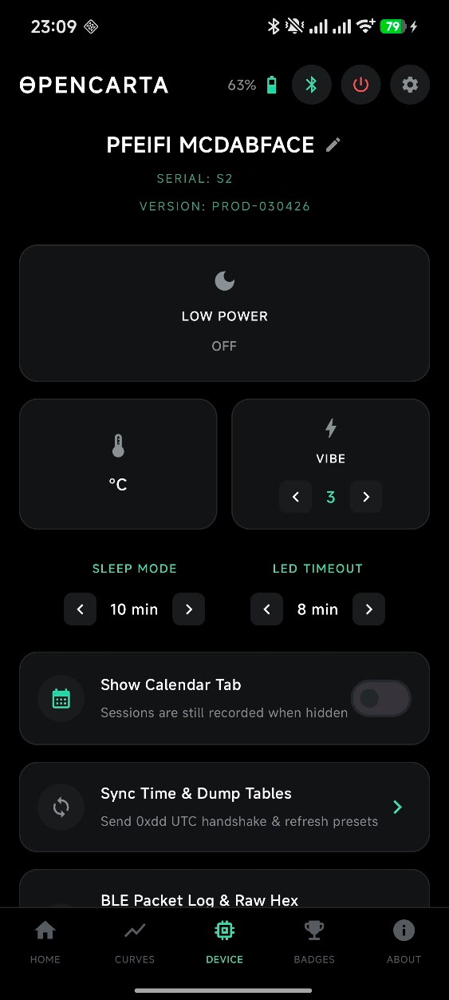
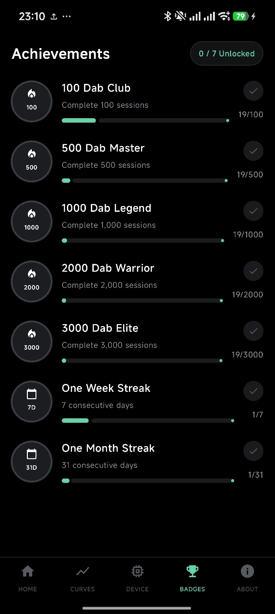

<div align="center">
  
  <h1>OpenCarta</h1>
  <p>
    <strong>Open-source native Android &amp; Web Bluetooth controller for the Focus V Carta Sport</strong>
  </p>
  <p>
    <a href="https://github.com/stefexec/OpenCarta/releases/latest">
      
    </a>
    <a href="LICENSE">
      
    </a>
    
    
  </p>
  <p>
    <a href="#-download">Download APK</a> •
    <a href="#-screenshots">Screenshots</a> •
    <a href="#-features">Features</a> •
    <a href="#-building-from-source">Build</a> •
    <a href="PROTOCOL.md">BLE Protocol Docs</a>
  </p>
</div>

---

No account required. No telemetry. No cloud lock-in. Just fast, direct Bluetooth Low Energy control over your **Focus V Carta Sport** and **Carta 2**—built from scratch with Kotlin & Jetpack Compose alongside a zero-install Web Bluetooth app and full GATT protocol documentation.

> **Tested Devices:** Verified on **Focus V Carta Sport** and **Focus V Carta 2**.

## 📥 Download

- **Android APK (Recommended):** Grab the latest signed APK from [**GitHub Releases**](https://github.com/stefexec/OpenCarta/releases/latest) (works great with [Obtainium](https://github.com/ImranR98/Obtainium) for automatic updates).
- **F-Droid:** Initial submission ([`fdroiddata!57055`](https://gitlab.com/fdroid/fdroiddata/-/merge_requests/57055)) was closed under F-Droid's 3-month maintenance policy and will be resubmitted once eligible.

> [!NOTE]
> Android 12+ will ask for **Nearby devices** permission for BLE scanning. On Android 8–11, Android requires **Location** permission for Bluetooth LE scans (OpenCarta never collects or transmits location data).

## 📱 Screenshots

<table>
  <tr>
    <td align="center"></td>
    <td align="center"></td>
    <td align="center"></td>
    <td align="center"></td>
    <td align="center"></td>
  </tr>
</table>

## ✨ Features

### Native Android App (`android/`)
- **Live Telemetry & Sesh Control:** Real-time atomizer temperature, battery percentage & charging status, remaining session countdown, heat-up / sesh state, and one-tap **Start / Stop** + **Power Off** (`0x11` `0xaf` flag).
- **Temperature Curve Studio:** Dedicated **Curves** tab with 5 built-in scientifically grounded profiles (*Quartz Banger Cooling Curve*, *Live Rosin Terpene Ladder*, *Cold-Start Smooth Ramp*, *Live Resin Flavor → Cloud*, *Flash Melt → Mellow Finish*), interactive drag-and-drop breakpoint editing with dot markers on the temperature scale, **Smooth** or **Stepped** interpolation, custom saved curves, and live target vs. atomizer graphing.
- **Presets & RGB LED Control:** Edit all 5 device presets (365°F–635°F, 20–90s) and configure LED mode (Solid / Pulse / Gradient / Rainbow), brightness, and custom RGB colors.
- **Device Settings & Diagnostics:** °F / °C toggle, haptic feedback, battery-saving mode, screen brightness, auto-reconnect, and live BLE packet debug log.
- **Stats, Achievements & Optional Sesh Calendar:** Local session counter, temperature & duration achievements, and an optional daily sesh calendar—stored strictly on-device.
- **Preserves Official App High Scores:** Sends UTC time sync (`0xdd`) and **never** clears the device's offline dab flash log (`0xfd`), so sessions stay intact if you ever open the official app.

### Zero-Install Web Bluetooth App (`index.html`)
- Runs directly in Chrome / Chromium / Edge / Brave on desktop and Android with no installation required.
- Includes live telemetry, preset editor, RGB LED control, Power Off, and the full Curve Studio.

### Full Reverse-Engineered BLE Protocol (`PROTOCOL.md`)
- Complete documentation of the Carta Sport / Carta 2 GATT services, characteristics, telemetry notifications, command opcodes (`0x11`, `0xaa`, `0x22`–`0x55`, `0xcc`, `0xd1`, `0xd2`, `0xdd`, `0xe0`–`0xea`, `0xfa`/`0xfc`/`0xfd`), and wire formats.

### Known Gaps & Unimplemented Protocol Bits
- **Dry Herb Mode:** Herb preset tables (`0x44`/`0x55`) and temp/timer bytes are parsed and preserved, but live Dry Herb session switching/controls are not yet implemented in the main UI.
- **Handshake Metadata (`0xce`, `0x82`):** Received on connect; not yet decoded or surfaced in the UI.
- **Additional Status / Fault Bits:** `0x99` Byte 2 bit `0x40` (atomizer attached) is implemented, while remaining fault/short/overheat bits, `0x99` Byte 4 high nibble (`0x10`), `0xfc` Byte 6 session flags (`0x61`), and Scan Response Byte 18 (`0x08`) are still uncaptured.
- **OTA & Counter Reset:** Telink OTA (`0x2b12`) and factory/dab-counter reset commands are not implemented.

## 🛠 Building from Source

### Android App
```bash
cd android
./gradlew assembleRelease
```
The unsigned release APK will be at `android/app/build/outputs/apk/release/app-release-unsigned.apk` (or use `./gradlew assembleDebug` for a debug build).

### Web Bluetooth UI
Web Bluetooth requires a secure context (`http://localhost` or `https://`):
```bash
python3 -m http.server 8000
```
Open `http://localhost:8000` in Chrome/Chromium and click **Connect Carta**.  
*(On Linux Chrome, enable `chrome://flags/#enable-experimental-web-platform-features` if BLE devices do not appear.)*

## 📄 License

Licensed under the [**GNU General Public License v3.0 or later**](LICENSE) (`GPL-3.0-or-later`).
